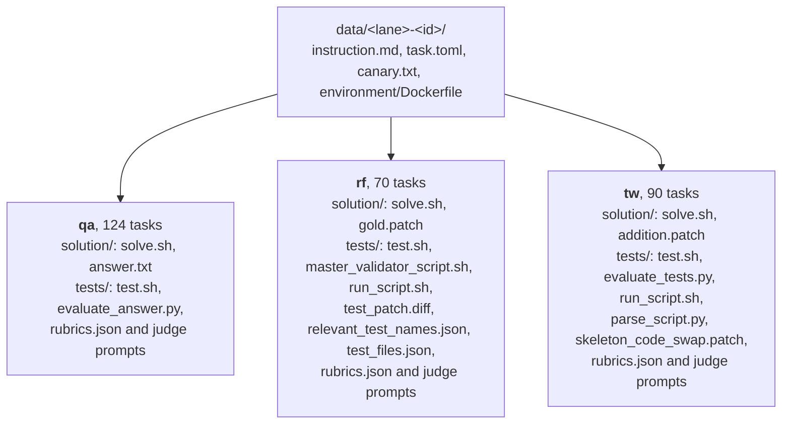
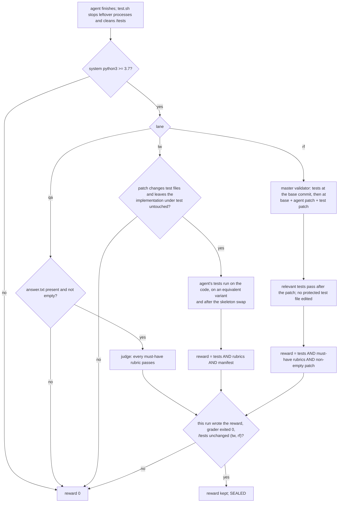

# SWE Atlas

Release: v1.01.100

[](https://arxiv.org/abs/2605.08366)

SWE Atlas is a benchmark for evaluating AI coding agents across a spectrum of professional software engineering tasks. Rather than measuring a single skill in isolation, SWE Atlas consists of multiple leaderboards that target distinct and complementary capabilities in the Software Development Cycle.

This repository has the data and instructions on running [SWE Atlas - Codebase QnA](https://labs.scale.com/leaderboard/sweatlas-qna), [SWE Atlas - Test Writing](https://labs.scale.com/leaderboard/sweatlas-tw) and [SWE Atlas - Refactoring](https://labs.scale.com/leaderboard/sweatlas-refactoring)

> **UPDATE:** The SWE Atlas Test Writing (TW), Refactoring (RF) and Codebase QnA (QA) tasks now run with internet access disabled, so reference solutions cannot be looked up online (use an agent API key limited to the model under evaluation, see [Environment Variables](#environment-variables)). TW and RF agents can reach only the API host of the agent under evaluation; QA agents can also reach an allowlist of select domains (package registries and language toolchains), leaving out any that serve the repository under question or its later releases. QA repositories keep only the git history up to the task's commit.
>
> Internet access is also restricted at the harness level — see `run_config/job.yaml` (e.g. `disallowed_tools: WebSearch,WebFetch` for Claude Code).
>
> **UPDATE (2026-10-14):** all 284 tasks now share one set of run settings: the judge can be
> configured through the optional `JUDGE_*` variables, every lane restricts the agent's network to
> an allowlist, build timeouts are 1800 s everywhere, verifier timeouts are set per lane in qa and
> tw and per task in rf, and CPU and memory are set per task.
>
> **UPDATE (2026-10-26):** the verifiers now defend grading against the state of the agent's
> container (leftover processes, planted reward files, git hooks and filters, credentials in the
> environment of agent code) and Refactoring enforces its protected test files. See
> [Grading integrity](#grading-integrity).

## Requirements

Install [uv](https://docs.astral.sh/uv/getting-started/installation/), then
[harbor](https://github.com/laude-institute/harbor) with its Modal extra. The extra is required:
a plain `uv tool install .` fails at run time with `MissingExtraError`.
```bash
git clone --branch v0.22.0 --depth 1 https://github.com/laude-institute/harbor.git
cd harbor
uv tool install '.[modal]'
```

### Pinned versions

The benchmark is validated on these versions. Harbor installs each agent inside the sandbox at run
time and takes the latest release unless a `version` kwarg is passed, so `run_config/job.yaml`
pins the agent it runs.

| Component | Version | Where it's pinned |
|---|---|---|
| harbor | 0.22.0 | the install command above |
| claude-code | 2.1.293 | the agent's `version` kwarg in `run_config/job.yaml` |
| codex | 0.142.1 | the codex `version` kwarg in `run_config/job.yaml` |
| mini-swe-agent | 2.4.6 | the mini-swe-agent `version` kwarg in `run_config/job.yaml` |
| litellm (installed with mini-swe-agent) | < 1.106 | `UV_CONSTRAINT` in every `task.toml`, pointing at a file the task's healthcheck writes; `LITELLM_LOCAL_MODEL_COST_MAP=True` keeps the agent from fetching the model cost map at start |

Each trial records the installed agent version in `agent/trajectory.json`. For mini-swe-agent,
harbor 0.22.0 doesn't write that file, so read the version from the
`uv tool install mini-swe-agent==<version>` line in the trial's `trial.log`.

Set up [Modal](https://modal.com/) for sandbox environments. Harbor's extra doesn't put the Modal
CLI on your PATH, so install it separately:
```bash
uv tool install modal
modal setup
```

## Environment Variables

Copy `.env.example` to `.env` in the root of the repository (`cp .env.example .env`) and fill it
in. The same file serves all three lanes, the scripts in `run_config/` and a plain
`harbor run --env-file .env`. It holds plain `NAME=value` lines; the blocks below write the
agent and judge variables as `export` lines. The agent variables:

```bash
# Agent under evaluation. claude-code reads the Anthropic variables; codex and mini-swe-agent read
# the OpenAI ones.
export ANTHROPIC_API_KEY=<your-anthropic-api-key>
export ANTHROPIC_BASE_URL=<optional, e.g. a LiteLLM proxy>
export OPENAI_BASE_URL=<optional, for codex and mini-swe-agent>
```

When `ANTHROPIC_BASE_URL` is set, harbor passes `MODEL` to claude-code unchanged. Use the model id
your proxy's Anthropic route expects, which is often without the `anthropic/` prefix
(`MODEL=claude-opus-4-6`).

To prevent solution lookup, every task restricts network access during `agent.run()`.

The agent reaches its API over an allowlisted hostname: enter only the hostname, without `https://`
or a path. For a pass@k run, set it in `run_config/job.yaml` under the agent's `extra_allowed_hosts`
(the file ships `api.anthropic.com` for claude-code). `run_config/qa_repro.sh` reads it from the
`HARBOR_AGENT_ALLOWED_HOST` environment variable and exits before running if it is unset.

Examples include `api.openai.com`, `api.anthropic.com`, or the hostname of your LiteLLM proxy. Harbor adds
this hostname to the task's agent-phase allowlist; hosts outside the allowlist remain blocked.

The agent's API key is readable inside the task container, so the agent can call any model or
server-side tool that key serves on the allowed host. Use a key limited to the model under evaluation,
without web-search models or web tools, so solutions cannot be looked up through that endpoint.

```bash
export HARBOR_AGENT_ALLOWED_HOST=<your-agent-api-hostname>   # for run_config/qa_repro.sh
```

LLM Judge (any OpenAI-compatible endpoint). We use GPT 6.1 Sol (`openai/gpt-6.1-sol`) as the
Judge model for rubric grading, at high reasoning effort. Every rubric and manifest verdict is the
majority of 3 judge votes, and the judge writes its justification before the verdict. No judge
settings are needed beyond these two credentials:

```bash
export OPENAI_API_KEY=<your-judge-api-key>
export OPENAI_API_BASE=<your-judge-base-url>  # e.g. https://api.openai.com/v1
```

This holds both for the scripts in `run_config/` and for a plain `harbor run`, which passes these
two variables to the verifier. `JUDGE_MODEL`, `JUDGE_REASONING_EFFORT` and `JUDGE_VOTES` (below)
change the model, effort and number of votes. Avoid `anthropic/claude-opus-4-7` as the judge: it
content-filters some qa tasks' rubrics, which zeroes the trial with `judge_unusable = 1` instead of
grading it.

codex and mini-swe-agent also read `OPENAI_API_KEY`, so with those agents one key serves both the
agent and the judge. The agents read their endpoint from `OPENAI_BASE_URL`, and the judge reads its
endpoint from `OPENAI_API_BASE`. They can be the same URL.

The verifiers of all three lanes read the judge from `JUDGE_API_KEY` / `JUDGE_BASE_URL` /
`JUDGE_MODEL` / `JUDGE_REASONING_EFFORT` / `JUDGE_VOTES`, and fall back to the variables above when
they are not set. Set the `JUDGE_*` variables explicitly in `.env` to use a different judge key,
endpoint, model, effort or number of votes, e.g.

```bash
export JUDGE_API_KEY=<your-judge-api-key>     # defaults to OPENAI_API_KEY
export JUDGE_BASE_URL=<your-judge-base-url>   # defaults to OPENAI_API_BASE
export JUDGE_MODEL=<judge-model>              # defaults to openai/gpt-6.1-sol (run_config/ scripts: EVAL_MODEL first)
export JUDGE_REASONING_EFFORT=high            # optional; defaults to high
export JUDGE_VOTES=5                          # optional; odd, defaults to 3
export JUDGE_API_DIALECT=anthropic-messages   # optional; unset picks it from the URL and model
```

`JUDGE_REASONING_EFFORT` overrides the default effort, the scripts in `run_config/` also accept
`EVAL_REASONING_EFFORT`, and the value `model default` sends no effort parameter.

`oracle.sh` and `nop.sh` exit before running anything if the judge key or endpoint is
missing; a `run_config/job.yaml` run does not pre-check and starts anyway. A key the endpoint
rejects is not caught up front either: every trial then scores 0 and the
verifier reports `judge refused to grade this task: judge HTTP 401`, so check the `not_graded`
metric when a run scores 0 across the board.

The verifiers pick the API dialect from the URL and model (`anthropic` in the hostname, or a bare
`claude*` model id with a base URL that has no path, selects the Anthropic Messages API; anything
else the OpenAI chat API), and `JUDGE_API_DIALECT=openai-chat|anthropic-messages` overrides it.

## Images

Every task runs on a prebuilt image: `docker_image` in `task.toml`, pinned by `@sha256` digest, and
an `environment/Dockerfile` that is only `FROM` that image. Harbor pulls each task's image by the
exact digest recorded in its `task.toml`. The images already contain everything harbor's agent setup
needs (claude-code, codex and mini-swe-agent), plus each task's own build steps, so harbor runs them
with no `--ek` arguments. The images are public on the GitHub Container Registry and are being
published under the Scale organization at `ghcr.io/scaleapi/swe-atlas-v1.1`.

## Running

Every task directory sits directly in `data/`, named `<lane>-<id>` — `qa-` for Codebase QnA, `tw-` for
Test Writing and `rf-` for Refactoring. A plain `harbor run -p data` runs all three lanes together; to
stay within one lane, pass `-i`/`-x` task filters or use the `run_config/` scripts, which select a lane
as every directory whose name starts with that lane's prefix. Every task directory has these main files:



`run_config/job.yaml` is a single harbor job config that runs pass@k for one agent over all three
lanes at once. Edit the model under evaluation and the agent's API hostname in it (both marked
`EDIT:`), put your keys in `.env`, and run `harbor run -c run_config/job.yaml --env-file .env -y`.
Its comments carry the codex and mini-swe-agent variants.

Three scripts in `run_config/` start the other runs: `oracle.sh` (reference solutions) and `nop.sh`
(an agent that does nothing), and `qa_repro.sh` is an optional check described below. Each runs the
lanes you name (default: `qa rf tw`, one after another; `qa` for `qa_repro.sh`), and passes anything
after `--` to every `harbor run`. In the scripts each lane is its own harbor dataset, so `-i`/`-x`
task filters apply within a lane, and task ids that aren't in a lane are ignored.

Try one task first to check your setup. The oracle should score `reward 1.0`:

```bash
bash run_config/oracle.sh qa -- -i qa-6905333b74f22949d97ba9cc
```

```bash
# pass@k for one agent over all three lanes (edit the model and agent host in run_config/job.yaml first)
harbor run -c run_config/job.yaml --env-file .env -y

# one lane only, or one task: add a task filter (also pass -p data so the filter has a dataset)
harbor run -c run_config/job.yaml -p data --env-file .env -y -i 'rf-*'
harbor run -c run_config/job.yaml -p data --env-file .env -y -i rf-69391d8d1ce51c407be1e533

# reference solutions
bash run_config/oracle.sh                                # all three lanes
bash run_config/oracle.sh rf -- -i rf-69391d8d1ce51c407be1e533
```

A `job.yaml` run writes to harbor's `jobs/` directory by default (set `jobs_dir` in the file or
`-o` on the command line to change it). `oracle.sh` and `nop.sh` end with one table over the lanes
they ran, from `run_config/summary.py`: tasks, trials, unfinished trials, errors, retries, trials
the judge did not grade, pass@1 and pass@k, one row per job. Pass a `job.yaml` run's job directory
to the same script, e.g. `python3 run_config/summary.py jobs/<job-name>`. An unfinished trial counts
as 0 in pass@1 and pass@k. The table is the same for every lane. On an empty submission qa and tw
skip the judge (not graded = 1), while rf judges the empty patch (not graded = 0).

`run_config/job.yaml` encodes the run settings below and the pinned agent version. The same run is
also expressible as a plain `harbor run`; apart from each agent's own kwargs the command is the same
in every lane. claude-code needs `--ak disallowed_tools=WebSearch,WebFetch`, codex
`--ak web_search=disabled`, and mini-swe-agent `--ak config_file=run_config/mswea/<lane>.yaml`, the
lane's prompt config and the one lane-specific parameter.

```bash
harbor run -p data -a oracle -e modal --env-file .env -y -i <task>
harbor run -p data -a claude-code -m <model> -e modal --env-file .env -y \
  --allow-agent-host <your-agent-api-hostname> --ak disallowed_tools=WebSearch,WebFetch -i '<lane>-*'
harbor run -p data -a mini-swe-agent -m <model> -e modal --env-file .env -y \
  --allow-agent-host <your-agent-api-hostname> --ak config_file=run_config/mswea/<lane>.yaml -i '<lane>-*'
python3 run_config/summary.py jobs                       # harbor's default output directory
```

The `run_config/` scripts (`oracle.sh`, `nop.sh`, `qa_repro.sh`) read these from the environment or
`.env`:

| Variable | Default |
|---|---|
| `MODEL` | `anthropic/claude-haiku-5-5` for `qa_repro.sh`; the oracle and nop use their own fixed agents |
| `K` | 1 for `qa_repro.sh`; the oracle and nop run once |
| `EFFORT` | `high` (`--ak reasoning_effort`, used by `qa_repro.sh`) |
| `N` | concurrent trials: 48 oracle and nop, 8 `qa_repro.sh` |
| `MAX_RETRIES` | 3 retries of infrastructure and agent-timeout failures; `0` turns retries off |
| `JOB_NAME`, `RESULTS_DIR` | `oracle`, `nop` and `qa_repro`; `results/` (results go in `results/<lane>/`) |
| `DRY_RUN=1` | print the `harbor run` commands without running them |

These can also be set in `.env`. A value passed on the command line takes priority over `.env`,
which takes priority over the default. For a `run_config/job.yaml` run, set the equivalent fields in
the file instead: `n_attempts` (pass@k), `n_concurrent_trials` (concurrency), `model_name`,
`reasoning_effort` and `retry.max_retries`.

Verifier timeouts are set per task, so no lane needs a timeout multiplier. In qa and tw, judging
sends no new call 2400 s after the verifier starts and a call in flight can take 600 s more, so qa
and tw verifiers get 3600 s (Test Writing runs its tests three times within that, up to 600 s
each). Refactoring sets them per task.

Each script and `run_config/job.yaml` retry the failures that are infrastructure rather than the
submission — environment, sandbox, healthcheck, agent-setup, agent-proxy (rate limit, 5xx, dropped
connection, DNS/TLS) and agent-timeout failures — up to `MAX_RETRIES` times in the scripts and
`retry.max_retries` in `job.yaml` (default 3; `0` turns retries off), deleting the failed attempt
first so nothing is double counted. Real outcomes are never retried and
are graded as they ran: a model refusal, a missing or rejected key, an unknown or unusable model, an
exhausted account usage limit, a reply over the token or context budget, and a reply the judge could
not parse. `summary.py` leaves a trial still erroring for an infrastructure reason out of pass@1.

Rerunning with the same job name resumes that job, and harbor refuses to resume it with a
different config (`FileExistsError`). Set `JOB_NAME` when you rerun with anything changed: a
different `K`, task filter or extra flags. To rerun only the trials that failed with a given
error, resume the job without them:
`harbor jobs resume -p results/<lane>/<job> -f EnvironmentStartTimeoutError`.

OpenAI's safety filter refuses some security-themed questions. In our runs codex with
`openai/gpt-6.1-sol` was refused on 7 qa tasks: the agent stops with `AgentSafetyRefusalError`,
which is not retried, and the trial scores 0 with `not_graded = 1`. The 7 tasks stay in the
benchmark and a refused trial counts as a failure. Report qa for OpenAI models both with and
without them; `run_config/summary.py` prints both rows for every qa agent job. The tasks are
`qa-6905333b74f22949d97ba9bb`, `qa-6905333b74f22949d97ba9c0`, `qa-6905333b74f22949d97ba9cb`,
`qa-6905333b74f22949d97ba9f1`, `qa-6905333b74f22949d97baa19`, `qa-6905333b74f22949d97baa1d`
and `qa-6905333b74f22949d97baa2c`.

```bash
python3 run_config/summary.py results/qa/<job> results/rf/<job>   # tasks, errors, pass@1, pass@k
```

To browse results, run `harbor view results/<lane>`.

`run_config/qa_repro.sh` is an optional check of the qa reference answers, not part of the score: an
agent runs every runtime claim of each `solution/answer.txt` in the task's pinned image, with the
verifier off, and the verdict for each claim goes to `results/qa/<job>/claims.csv`. Nothing is written
to `data/`. For example: `bash run_config/qa_repro.sh -- -i qa-6905333b74f22949d97baa0c`.

## Release record

Every release is checked on its final bytes: the reference solutions score 1 and an agent that
does nothing scores 0 on every task. A release ships only when this gate passes, and its table is
published with the release.

```bash
JOB_NAME=oracle-<release> bash run_config/oracle.sh
JOB_NAME=nop-<release> bash run_config/nop.sh
python3 run_config/summary.py --gate results/*/oracle-<release> results/*/nop-<release>
```

`summary.py --gate` prints the release-record table and exits 1 unless every task in `data/` has an
oracle and a nop trial, every oracle trial scores 1, every nop trial scores 0, no trial errored, and
every trial ran on the task bytes now in `data/` (the task digest harbor records in each trial's
`lock.json`). The table also shows the judge model, effort and votes each lane's trials were graded
with.

## Grading integrity

Harbor grades each trial inside the agent's own container, so the verifiers assume nothing the
agent could have touched. Every lane's `tests/test.sh` does the same things, in this order:

- **Before grading** it stops every process the agent left running (only harbor's keepalive
  survives), empties `/logs/verifier`, deletes any bytecode next to the graders and every entry in
  `/tests` that the task does not ship (twice, the second time after the processes are stopped),
  and in Test Writing and Refactoring it rewrites the repository's `.git/config` so that only
  harmless keys remain: hooks, `core.fsmonitor`, filters, diff drivers and includes are dropped,
  and `~/.gitconfig` is never read. What it found is recorded in `/logs/verifier/integrity.json`
  and printed in an `=== INTEGRITY ===` section.
- **During grading** the agent's code (test runs, builds, the Refactoring master validator) runs
  without `JUDGE_*`, `OPENAI_*`, `EVAL_*`, `ANTHROPIC_*` or `VERIFIER_*` in its environment, and
  whatever it leaves running is stopped as soon as it finishes. In Refactoring, an
  edit to any file listed in `tests/test_files.json` sets the tests gate to 0, as the task text
  says. A judge reply that cannot be parsed, or that echoes a different criterion than the one sent,
  fails that rubric: every must-have has to be rated and pass. An empty Refactoring patch (the
  agent changed nothing) scores 0.
- **After grading** it stops anything started meanwhile and keeps the reward only if this run
  wrote it (`verifier_run_id` in `evaluation_results.json` matches, the three reward files agree,
  and the grader exited 0); otherwise it writes reward 0 with the reason. In Test Writing and
  Refactoring, where the agent's code runs during grading, a file in `/tests` that changed since
  the cleanup also scores 0: Test Writing checks the runner, parser, comparison script and skeleton
  patch before each use, Refactoring checks `/tests` right after the master validator, and both
  check all of `/tests` again before sealing. A `=== SEALED: ... ===` line closes the log.

How a trial's reward is decided:



The interpreter and the runner are not the agent's. Every grader step runs on the image's system
`python3` as `-I -S -B` (isolated, no site processing, no bytecode), so a `.pth` or
`sitecustomize` planted in site-packages, a `PYTHONPATH`, or a tool the agent installed never
reaches the graders; without a system `python3` of 3.7 or later the trial scores 0 with the
reason. In Test Writing the test runner is `tests/run_script.sh`, uploaded with the verifier after
the agent finished and hash-checked before each use; the image's copy is never used for grading.

What this does and does not give you: the checks stop the routes that have been demonstrated
(planted reward files, leftover writers, git hooks and filters, credentials in the environment,
startup files on the interpreter, a replaced runner or grader file, byte-exact detector tests).
They are not a sandbox. The runner and graders are shipped and hash-checked, but the agent's own
code that runs during grading (its tests, builds) runs as the same user and is not isolated from
them. Grading still runs inside the agent's container as its user, and a deliberately
tampering agent with root can in principle alter anything in that container, including the
interpreter itself. Grading in a separate container (Harbor's `[verifier] environment_mode =
"separate"`) is the structural answer and is being evaluated.

The Test Writing manifest check (`tests/manifest_system_prompt.txt`) differs from the original SWE
Atlas release. It counts a test by its test logic rather than by assertion calls, and it accepts Go
tests without an assertion helper, Go subtests listed on their own, under their parent or only
through their parent, and the existing top-level test that runs new suite methods. Rejudged on the
stored reference and agent manifests with two judges, it accepts more correct manifests than the
original prompt. Of the 474 incorrect manifests in that set, made by dropping, inventing or adding
one pre-existing test in a correct manifest, each prompt accepted one with one judge and none with
the other.

## Disclosures

Deliberate changes versus the original SWE Atlas v1.1 release and the Artificial Analysis (AA)
baseline, recorded for AA parity transparency. Other hardening and grader fixes in this release are
grading-neutral and are not listed here.

### tw-6902ef3ab97fe23e2ad27253 — prompt broadened

The testing objective (`instruction.md`) and the agent prompt (`tests/prompt.txt`) were broadened in
two places so the ask matches the gold test suite's must-haves (criteria 1.4, 1.5, 1.6 and 1.24).

Before:

> Basically: load raw images (both 24 and 32-bit) including when the data comes in chunks, load PNGs in a couple common modes (RGBA/RGB and grayscale ish), have one super tiny PNG sanity check + make sure bad PNG data errors out, cover using IDs vs numbers for load/put/delete (also chunked), and poke the animation frame stuff (new frames, edits/partial edits, composing from another frame, deleting frames, and the gap timing bits).

After:

> Basically: load raw images (both 24 and 32-bit) including when the data comes in chunks or from a file, a temp file or shared memory, load PNGs in a couple common modes (RGBA/RGB and grayscale ish), have one super tiny PNG sanity check + make sure bad PNG data errors out, cover using IDs vs numbers for load/put/delete (also chunked), and poke the animation frame stuff (new frames, edits/partial edits, composing from another frame, deleting frames, switching the current frame, and the gap timing bits).

The two additions are "or from a file, a temp file or shared memory" and "switching the current
frame,", broadening the ask to match the gold must-haves (criteria 1.4, 1.5, 1.6 and 1.24).

## License

This repository is released under the Apache License 2.0; see [LICENSE](LICENSE). Some qa rubric
criteria reuse wording from the Artificial Analysis SWE-Atlas-QnA-AA dataset; that attribution and
the changes it carries are recorded in [NOTICE](NOTICE).

## Citation

If you use SWE Atlas in your research, please cite our paper:

```bibtex
@misc{raghavendra2026sweatlasbenchmarkingcoding,
      title={SWE Atlas: Benchmarking Coding Agents Beyond Issue Resolution},
      author={Mohit Raghavendra and Soham Dan and Miguel Romero Calvo and Yannis Yiming He and Johannes Baptist Mols and Gautam Anand and Cole McCollum and Edgar Arakelyan and Vijay Bharadwaj and Andrew Park and Jeff Da and MohammadHossein Rezaei and Bing Liu and Brad Kenstler and Yunzhong He},
      year={2026},
      eprint={2605.08366},
      archivePrefix={arXiv},
      primaryClass={cs.LG},
      url={https://arxiv.org/abs/2605.08366},
}
```
